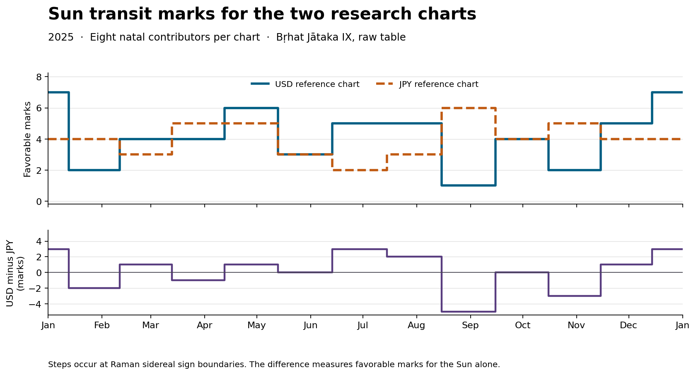

# Same calculation, two reference charts

At 2025-05-31 17:00 UTC the archived Raman sidereal longitudes were evaluated against the two registered founder hypotheses. USD uses Philadelphia, 1776-07-04 16:56:02 UTC; JPY uses Tokyo, 1889-02-10 15:00:00 UTC. The natal Moon longitudes are 304.72448° and 61.08767°. This is an offline illustration using chart identities as supplied. The registry's restrictions on live pair derivation, polarity and functional lordship remain in force. Source texts address human nativities. Currency interpretation is experimental.

| Transit graha | Longitude | USD place and particular reading | JPY place and particular reading |
|---|---:|---|---|
| Sun | 47.72538° | 4, adverse health/companionship | 12, attaining goal conditional on means |
| Moon | 108.87498° | 6, favorable recovery | 2, adverse standing/resources |
| Mars | 118.13669° | 6, favorable relief | 2, adverse authority/disputes |
| Mercury | 49.62844° | 4, favorable family/gain | 12, adverse disgrace/illness |
| Jupiter | 65.16794° | 5, favorable prosperity | 1, adverse loss/displacement |
| Venus | 1.88166° | 3, favorable esteem | 11, favorable material gain |
| Saturn | 337.70025° | 2, mixed temporary gain/frailty | 10, mixed employment/loss |

These are the actual sign-indexed states in Iyer’s selected chapter. In the v49 timing reading Sun and Mars are beyond the first half, Moon lies in the latter half and Saturn lies in the first; v54 raises a separate Saturn timing issue. Mercury applies throughout. Jupiter is in an odd sign whose “middle” lacks a quantified window here. In the separate Phaladīpikā lane, USD Mercury 4 has Venus in paired place 3. JPY Mercury 12 has no favorable v6 assignment to test. No seven-body vote or blanket judgment of either chart follows.

**Common-unit certificate for raw marks.** Inputs and SHA-256 digests are in the JSON. The seven natal longitudes are those of the archived fixture. Compute the eighth input with Swiss Ephemeris 2.10.03, Raman sidereal mode, houses_ex with whole-sign flag W and the returned ascendant longitude at the registered latitude/longitude. The UTC epoch approximates UT1 for this offline ascendant check. ±1 minute produced USD 170.178°–170.578°, JPY 204.620°–205.028°, both retaining their signs. This sensitivity check does not validate the historical founding times. For each graha both charts use the same eight masks, unit, orientation and pre-reduction stage. A mark measures satisfaction of one qualifying natal-reference condition. Zero is absence of favorable marks; a signed mark difference is descriptive. It does not measure currency strength.

| Graha, occupied sign | USD bits · sum | JPY bits · sum | USD minus JPY raw count |
|---|---|---|---:|
| Sun, Taurus | 00010110 · 3 | 10001010 · 3 | 0 marks |
| Mars, Cancer | 01100011 · 4 | 10010011 · 4 | 0 marks |

The Sun Taurus-to-Gemini comparison gives 5−2=**+3 raw marks** in Gemini versus 3−3=0 in Taurus. This counterfactual varies only the selected transit sign, with natal data fixed. Raw sign-cycle counts for every sign on both sides appear in the ledger. Equal count can hide different contributors. Likewise equal count before applying dignity conditions can lead to different interpreted results. If Lagna alone is unknown for both charts with other data fixed, its contribution to a difference is in {−1,0,1}. Larger time changes can also shift planets or natal Moon. Recompute entire charts for those scenarios.

| Candidate | Comparable measurement | Subtraction judgment |
|---|---|---|
| Same raw Sun count, same stage | Equal-weight marks, bounded 0–8, exact zero | Descriptive difference has units of marks. Classical cross-currency outcome operator unestablished. |
| Lunar Iṣṭa/Kaṣṭa, same ray recension | Paired 60-part tendency at casting epoch | Can compare homologous component arithmetic; chart/period application and subject bridge missing. Never combine I and K as independent votes. |
| Ucca or Dṛk | Same type of strength in same units and comparable contexts | Difference reports strength only; sign of phala cannot be inferred. |
| Vyas Vedha | Same specific target and eligible modifier profile | Joint modifiers and cross-subject target identity must close first. |
| Tājika | Common solar-day scale for intervals | Durations can be subtracted as durations. Mixed period domains or favorable/adverse labels have no time-unit difference. |
| Gochara or battle category | Same ordered domain where an order exists | Report paired states, dominance or incomparability. No unit distance. |
| Arghya | Commodity and reference unit required | Fraction of one commodity reference cannot supply a currency phala scale. |

For a future scalar W(t)=I_USD(t)−I_JPY(t), require identical measured construct, origin, unit and interpretation under corresponding targets; approved transformation of two foundational charts into subjects; source-governed realization or an expressly frozen experimental one; joint sensitivity; and an independently tested market bridge if direction is ever claimed. The per-planet raw arithmetic above meets only the narrow measurement question.

## One year of raw Sun marks

The independent 2025 calculation used the registered natal signs and Swiss Ephemeris 2.10.03 with explicitly selected Moshier and Raman settings. Each Sun ingress was bracketed daily and refined to one second in the computational model, using UTC as UT. On 13 June the Sun moves from 59.99999144° at 12:53:50 UTC to 60.00000250° at 12:53:51. The USD count rises from 3 to 5 while JPY falls from 3 to 2. Across 2025 the difference spans −5 to +3 marks. The ledger contains all twelve sign changes, plus start and end records. These results describe the sign masks and astronomical inputs. No price series enters either panel.
